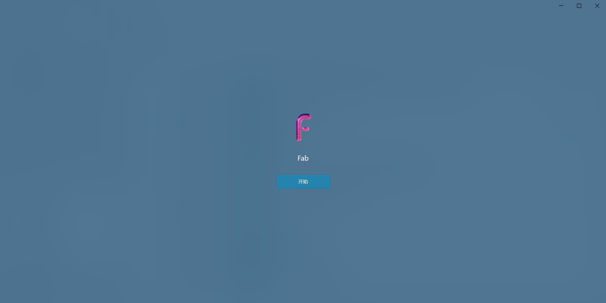

    
    
Fabulous

    
一个面向阅读、写作与研究整理的跨平台桌面工作区。

    
    

# Fabulous Desktop

Fabulous Desktop 是 Fabulous 生态的本地 Electron 桌面版。

它把本地笔记编辑、研究资料整理、文件路径工作流和桌面端交互整合在同一个应用里。

## 文档

- [English Guide](./English.md)
- [开发说明](./README.dev.md)

## Fabulous 能做什么？

Fabulous 提供：

- 支持 `.fbn`、Markdown、HTML、JSON 的本地笔记编辑
- 所见即所得的快速写作体验
- 本地文件夹浏览与文件管理
- 面向 PDF 阅读与文献整理的工作流
- 支持从系统中直接双击打开 `.fbn` 文件

## 支持平台

- Windows 10 / 11
- macOS

## 快速开始

**下载安装**

请从这里下载最新版本：

- <https://github.com/Creator-SN/Fabulous/releases>

**首次启动**

第一次打开应用后，你可以直接从本地笔记区域开始使用。

如果你还需要更完整的文献整理流程，Fabulous 也可以继续承担更完整的桌面研究工作区角色，而不只是一个笔记编辑器。

## 引言
Fabulous（FAB）是一款集科研文献管理与快速笔记于一体的应用，能帮助你快速整理学术资料（PDF 解析、Bibtex 获取、打标签、做笔记等），也能让你轻松撰写格式优雅的技术资料。
下面我们就来看看如何开始使用 FAB：笔记本入门
### 1. 添加数据源
+ 如果你刚注册账号，还没有建立任何数据源，请先前往**设置**，然后点击**添加数据源**，即可建立属于你自己的数据源。

+ 你也可以加入他人创建的数据源，加入方式有两种：
  - A. **输入邀请码**加入
  - B. 由对方**添加你的账户**后加入
---

### 2. 笔记本管理

笔记本的管理方式和在 PC 上管理文件夹/文件一样，逻辑十分清晰：你可以在数据源下添加任意目录和笔记。
---

### 3. 权限管理
1. 数据源支持权限管理，你可以创建**权限组，**批量对用户进行权限管理。如果你需要邀请用户进入自己的数据源，则必须至少创建一个权限组。

此外，权限组中的用户可以设为**普通成员**或**管理员**；管理员可以在本权限组内邀请其他成员加入。

2. 权限组共有**读、写、删除、权限管理**四大权限类型。这里的权限指的是数据源权限，也就是全局权限：科研模块下的所有论文项目和笔记都遵循全局权限，无法细粒度调控；而笔记本则可以按目录和笔记进行精细调控。其中，**权限管理**表示该组用户可以对笔记本下的目录和笔记进行权限修改。

3. 目录和笔记的权限可以在导航栏右侧选择**权限**来管理：

在 FAB 中，权限是链式传导的：在“A→B→C”中，要想获得 C 的权限，必须先获得前序 A、B 的权限，因此每个目录和笔记都具有与数据源相同的四种权限类型。

一般而言，为了让相关用户拥有子目录和笔记的操作权限，上层目录也必须赋予相应权限，这可能导致他们直接对上层目录执行**删除**这种危险操作。为防止此类情况发生，可以为需要保护的上层目录勾选**“受保护的目录”**从而防止删除；同时，只有拥有**权限管理**权限的用户才能启用或关闭**“受保护的目录”**权限。
4. 收藏和共享

在创建的笔记上方，红框内的两个按钮分别是**收藏**和**共享**；收藏的笔记可以在**集合和分享**中的收藏夹查看，并且可以把单篇笔记收藏到多个文件夹。

共享笔记分为**数据源成员**共享和**公开**共享两种：

+ **数据源成员：**笔记所在数据源下的所有成员均可**查看**/**编辑**笔记。
+ **公开：**所有互联网用户均可**查看**笔记，所有已登录用户均可**编辑**笔记。
> 特别说明：如果在同一目录下分享了多篇笔记，可以在编辑器左上角的下拉菜单中查看该目录下的集锦。需要注意的是，被分享笔记所在的目录也会一并公开可见。

科研入门
### 1. 切换科研分区

1. 首先，在左上方可以看到**科研**分区，点击它即可切换为科研模式下的导航栏。
2. 在科研模式中，我们可以添加**区组**和**分区**这两种结构。其中，区组是可以嵌套叠加的结构，你可以把它看作可以包含多个分区的**文件夹；**分区则是多篇文献项目的集合。你可以参考上图的定义，把区组视为某个课题/研究领域的大分组，把分区视为细分方向（如 CNN/RNN/Diffusion）对应的技术路线。
---

### 2. 引入论文 PDF

1. 引入论文有两种方式：一种是直接**拖入 PDF 文件**，FAB 会自动解析并生成元数据。

可以看到，解析完成后出现了一个**“项目”。**要注意，这里的项目不只是 PDF，它包含（PDF + 元数据 + 若干笔记 + 标签等）信息；图中的绿色数字代表年份信息，论文标题也已自动解析。
另一种方式是点击工具栏上的**添加**手动新建一个项目，再右键点击该项目、修改 PDF 文件来添加论文；这种方式相对繁琐，仅作备用。
2. 由于 PDF 解析存在不稳定性，如果解析出的标题样式奇怪，或者没有检索到年份等信息，你可以**手动修改标题并检索**：

如果在检索过程中能够获取到**DBLP**数据源的数据，还能自动获得 Bibtex 信息，之后直接点击项目上的橙色**B**按钮即可复制 Bibtex。
---

### 3. 添加笔记
整理好论文信息后，你可以在项目中点击**“添加笔记”**开始记录论文想法：

1. 选择需要的模板预设，完成创建。

2. 进入笔记后，你可以**添加头图**、**修改标题**，也可以点击左上角的 **PDF** 按钮进入**双栏阅读模式**。

FAB 一项很惊艳的功能是支持**PDF 高亮部分与笔记快速联动**，帮助你更好地回忆起笔记对应的原文。

## 桌面版特性

相比纯 Web 前端，桌面版额外支持：

- 本地文件与文件夹访问
- 自定义标题栏与窗口控制
- 单实例运行
- `.fbn` 文件关联
- 自动更新集成

## License

GPL 3 License
