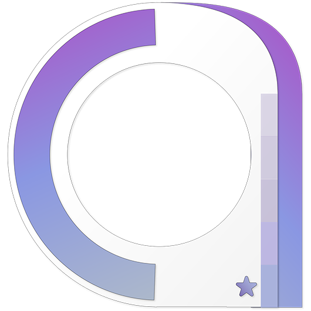
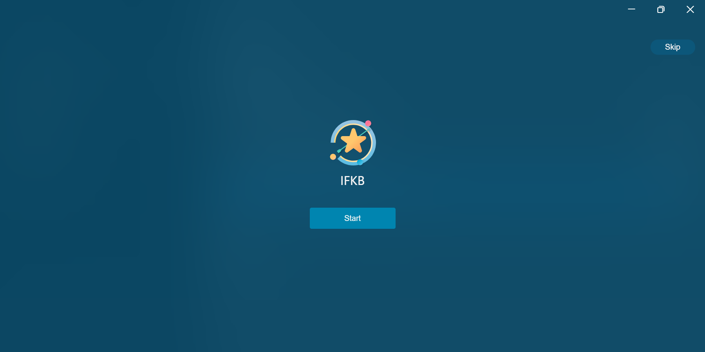

    
    
Fabulous

    
A cross-platform desktop workspace for reading, writing, and organizing research notes.

    
    

# Fabulous Desktop

Fabulous Desktop is the local Electron edition of the Fabulous ecosystem.

It combines local notebook editing, research material organization, file-based workflows, and desktop-native interactions in one place.

## Documents

- [中文说明](./Chinese.md)
- [Developer Guide](./README.dev.md)

## What can Fabulous do?

Fabulous provides:

- local notebook editing with `.fbn`, Markdown, HTML, and JSON support
- quick WYSIWYG note writing
- local folder browsing and file management
- PDF-centered reading and literature workflows
- desktop file association so `.fbn` files can be opened directly from the system

## Platform

- Windows 10 / 11
- macOS

## Quick Start

**Install**

Download the latest release from:

- <https://github.com/Creator-SN/Fabulous/releases>

**First Launch**

After opening the app for the first time, you can start directly from the local notebook area.

If you also need the wider literature-management workflow, Fabulous can continue to serve as a richer desktop workspace beyond note editing alone.

## Introduction
Fabulous (FAB) is an app that combines research literature management with quick note-taking. It helps you organize academic materials quickly (PDF parsing, BibTeX retrieval, tagging, note-taking, and more) and lets you easily write well-formatted technical documents.
Let us look at how to get started with FAB:Getting Started with Notebooks
### 1. Add a Data Source
+ If you have just signed up and have not created any data source yet, first go to **Settings**, then click **Add Data Source** to create your own data source.

+ You can also join data sources created by others, in one of two ways:
  - A. **Enter an invitation code** to join
  - B. Have the other party **add your account** so that you can join afterwards
---

### 2. Managing Notebooks

Notebooks are managed just like folders and files on a PC, with very clear logic: you can add any number of directories and notes under a data source.
---

### 3. Permission Management
1. Data sources support permission management: you can create **permission groups **to manage user permissions in bulk. If you want to invite users to your own data source, you must create at least one permission group.

In addition, users in a permission group can be set as **regular members** or **administrators**; administrators can invite other members to join within this permission group.

2. A permission group has four permission types: **read, write, delete, and permission management**. These permissions refer to data source permissions, that is, global permissions: all paper projects and notes in the research module follow the global permissions and cannot be tuned at a finer granularity, whereas notebooks can be controlled precisely by directory and note. Among them, **permission management** means that users in this group can modify permissions for the directories and notes under the notebook.

3. Permissions for directories and notes can be managed by selecting **Permissions** on the right side of the navigation bar:

In FAB, permissions are inherited in a chain: in “A→B→C”, you must first have permission for A and B in order to obtain permission for C, so every directory and note has the same four permission types as the data source.

Generally, to let the relevant users operate on subdirectories and notes, the parent directories must also be granted the corresponding permissions, which may allow them to directly perform a **delete** on the parent directory — a dangerous operation. To prevent this, you can check **“Protected directory”** for the parent directories to be protected, which prevents deletion. In addition, only users with the **permission management** permission can enable or disable the **“Protected directory”** permission.
4. Favorites and Sharing

Above a note you have created, the two buttons in the red box are **Favorite** and **Share**. Favorited notes can be viewed in the **Collections and Sharing** favorites, and a single note can be favorited into multiple folders.

Shared notes fall into two categories: **data source member** sharing and **public** sharing:

+ **Data source members: **all members of the data source that contains the note can **view**/**edit** the note.
+ **Public: **any internet user can **view** the note, and any logged-in user can **edit** the note.
> Special note: if you share several notes in the same directory, you can view the collection for that directory in the drop-down menu at the top left of the editor. Keep in mind that the directory containing a shared note also becomes publicly visible.

Getting Started with Research
### 1. Switching to the Research Section

1. First, at the top left you can see the **Research** section; click it to switch the navigation bar to research mode.
2. In research mode, you can add two kinds of structures: **groups** and **sections**. A group is a nested, stackable structure that you can think of as a **folder** that can contain multiple sections, whereas a section is a collection of paper projects. Following the definitions in the figure above, you can treat a group as the broad grouping for a topic or research field and a section as the technical route for a specific sub-direction (such as CNN, RNN, or Diffusion).
---

### 2. Importing Paper PDFs

1. There are two ways to import a paper. One is to **drag a PDF file in**, and FAB will parse it and generate the metadata automatically.

As you can see, once parsing is complete, a **“project” appears.**Note that a project here is not just a PDF: it contains the PDF, metadata, several notes, tags, and other information. The green number in the figure represents the year, and the paper title has also been parsed automatically.
The other way is to click **Add** on the toolbar to create a project manually, then right-click that project and change its PDF file to add the paper; this method is fairly cumbersome, so use it only as a fallback.
2. Because PDF parsing can be unreliable, if the parsed title looks strange or information such as the year is not found, you can **manually edit the title and search**:

If **DBLP** data is retrieved during the search, the BibTeX information is obtained automatically as well; then simply click the orange **B** button on the project to copy the BibTeX.
---

### 3. Adding Notes
Once the paper information is organized, you can click **“Add Note”** in the project to start recording your thoughts on the paper:

1. Select the template preset you need to finish creating the note.

2. After entering the note, you can **add a header image**, **edit the title**, or click the **PDF** button at the top left to enter **two-column reading mode**.

One impressive feature of FAB is its support for **quick linking between PDF highlights and notes**, which helps you better recall the original passage behind a note.

## Desktop Features

Compared with the pure web frontend, the desktop edition additionally supports:

- local file and folder access
- desktop title bar and window controls
- single-instance behavior
- `.fbn` file association
- automatic update integration

## License

GPL 3 License
